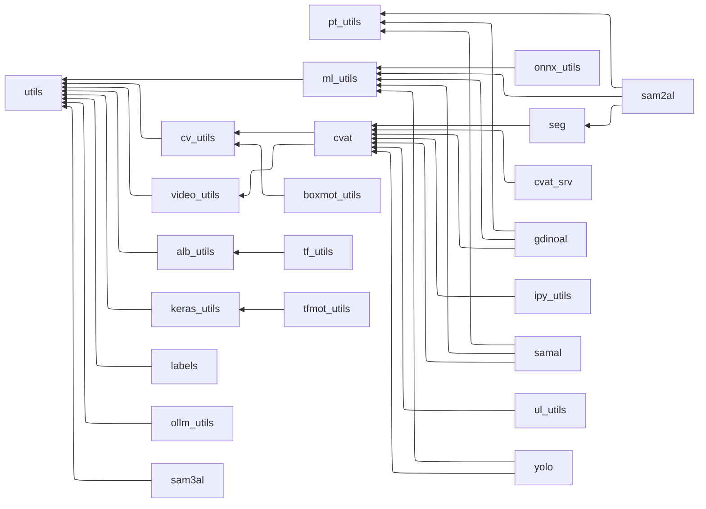

# 🧠 dl_utils: Утилиты для глубокого обучения

Набор инструментов для задач технического зрения, работы с разметкой и
автоматизации процессов глубокого обучения. Репозиторий предназначен для
подключения в основной проект как подмодуль.

## 🚀 Быстрый старт

Подключите репозиторий как подмодуль основного проекта:

```bash
git submodule add git@github.com:NikitaShubin/dl_utils.git 3rdparty/dl_utils
```

Добавьте корень `dl_utils` в `sys.path` или `PYTHONPATH`. В корне основного
проекта это выглядит так:

```python
import sys

sys.path.append('3rdparty/dl_utils')
```

Для ноутбука путь зависит от рабочей директории Jupyter: из папки
`notebooks/` это `../3rdparty/dl_utils`, из корня проекта —
`3rdparty/dl_utils`.

Для скрипта надёжнее считать путь от файла, а не от текущей директории:

```python
# scripts/experiment.py
from pathlib import Path
import sys

root = Path(__file__).resolve().parents[1]
sys.path.append(str(root / '3rdparty' / 'dl_utils'))
```

[`Template.ipynb`](Template.ipynb "Перейти к файлу") делает это
автоматически: ищет `3rdparty/dl_utils` вверх по дереву от текущей папки,
поэтому работает и из корня проекта, и из вложенных папок. Он также
выставляет переменные окружения для CUDA, ONNX и Keras. Скопируйте его в
рабочий ноутбук или перенесите одну ячейку.

Проверьте, что модуль импортируется:

```python
from video_utils import ViRead

with ViRead('data/video.mp4', colorspace='rgb') as frames:
    print(next(frames).shape)
```

### 🐳 [Готовое окружение](docs/docker.md)

Все зависимости уже собраны в Docker-образе с GPU, JupyterLab и OpenCode.
Из корня `dl_utils` запустите:

```bash
docker/restart.sh
```

`restart.sh` пересобирает образ и открывает консоль от пользователя хоста.
Войти под root можно через `docker/openroot.sh`, повторно открыть обычную
консоль — через `docker/open.sh`. Корень основного проекта монтируется в
`/workspace`, поэтому пути внутри контейнера совпадают с путями на хосте.

## 🧩 Основные модули

### 🛠️ Утилиты общего назначения

- **[utils.py](docs/modules/utils/README.md "Перейти к документации")**:
  файлы, изображения и видео, параллельная обработка, сериализация, тайминг
  и диагностика
- **[ipy_utils.py](docs/modules/ipy_utils.md "Перейти к документации")**:
  виджеты и интерактив для
  [Jupyter](https://jupyter.org "Перейти на официальный сайт")
- **[ollm_utils.py](docs/modules/ollm_utils.md "Перейти к документации")**:
  клиенты
  [Ollama](https://ollama.com "Перейти на официальный сайт")-серверов

### 📷 Техническое зрение (CV)

- **[cv_utils.py](docs/modules/cv_utils.md "Перейти к документации")**:
  боксы, маски, NMS, геометрия и визуализация аннотаций
- **[video_utils.py](docs/modules/video_utils.md "Перейти к документации")**:
  чтение, обработка и сохранение видео, оптический поток
- **[alb_utils.py](docs/modules/alb_utils.md "Перейти к документации")**:
  аугментации на базе
  [Albumentations](https://albumentations.ai "Перейти на официальный сайт")
- **[ul_utils.py](docs/modules/ul_utils.md "Перейти к документации")**:
  инференс и трекинг
  [Ultralytics](https://www.ultralytics.com "Перейти на официальный сайт")
  YOLO
- **[yolo.py](docs/modules/yolo.md "Перейти к документации")**:
  экспорт задач и бекапов в YOLO-датасет
- **[seg.py](docs/modules/seg.md "Перейти к документации")**:
  фильтры масок и сегментационные датасеты
- **[boxmot_utils.py](docs/modules/boxmot_utils.md "Перейти к документации")**:
  трекеры
  [BoxMOT](https://github.com/mikel-brostrom/boxmot "Перейти к репозиторию")

### ⚙️ Авторазметка

- **[samal.py](docs/modules/samal.md "Перейти к документации")**:
  автоматическая сегментация изображений с
  [SAM](https://github.com/facebookresearch/segment-anything "Перейти к репозиторию")
- **[sam2al.py](docs/modules/sam2al.md "Перейти к документации")**:
  интерактивная сегментация видео с
  [SAM 2](https://github.com/facebookresearch/sam2 "Перейти к репозиторию")
- **[sam3al.py](docs/modules/sam3al.md "Перейти к документации")**:
  загрузка весов SAM 3.1
- **[gdinoal.py](docs/modules/gdinoal.md "Перейти к документации")**:
  открытая детекция по текстовым запросам с
  [Grounding DINO](https://github.com/IDEA-Research/GroundingDINO "Репозиторий")

### 🏷️ Работа с CVAT

- **[cvat.py](docs/modules/cvat/README.md "Перейти к документации")**:
  набор утилит для оффлайн-работы с
  [CVAT](https://www.cvat.ai "Перейти на официальный сайт")-данными
- **[cvat_srv.py](docs/modules/cvat_srv/README.md "Перейти к документации")**:
  набор утилит для онлайн-работы с серверами
  [CVAT](https://docs.cvat.ai/docs/api_sdk/sdk/ "Перейти к документации SDK")
  (API-клиент)
- **[labels.py](docs/modules/labels.md "Перейти к документации")**:
  метки и суперметки из Excel, CSV и TSV; шаблоны
  [меток](labels_template.xlsx "Скачать шаблон") и
  [суперметок](superlabels_template.xlsx "Скачать шаблон")

### 🤖 Глубокое обучение

- **[pt_utils.py](docs/modules/pt_utils.md "Перейти к документации")**:
  устройство, датасет и слои
  [PyTorch](https://pytorch.org "Перейти на официальный сайт")
- **[keras_utils.py](docs/modules/keras_utils/README.md "Перейти к документации")**:
  модели, слои, метрики и колбеки
  [Keras](https://keras.io "Перейти на официальный сайт")
- **[tf_utils.py](docs/modules/tf_utils.md "Перейти к документации")**:
  инициализация
  [TensorFlow](https://www.tensorflow.org "Перейти на официальный сайт")
  и `tf.data`-конвейеры
- **[tfmot_utils.py](docs/modules/tfmot_utils.md "Перейти к документации")**:
  квантизация и прунинг TensorFlow с помощью
  [tfmot](https://www.tensorflow.org/model_optimization "Перейти к документации")
- **[ml_utils.py](docs/modules/ml_utils.md "Перейти к документации")**:
  общие ML-функции: метрики и обработка данных
- **[onnx_utils.py](docs/modules/onnx_utils.md "Перейти к документации")**:
  конвертация, квантизация и инференс
  [ONNX](https://onnx.ai "Перейти на официальный сайт")-моделей

<!-- markdownlint-disable MD033 -->
<details>
<summary>🔄 Зависимости модулей</summary>

Граф — транзитивная редукция: нарисованное ребро `A → B` означает прямой
импорт `A` из `B`, но часть прямых импортов не рисуется, если до `B` есть
более длинный путь. Сплошная стрелка — импорт верхнего уровня, пунктирная —
импорт внутри условия или функции. Уровни зависимостей идут справа налево:
слева базовые модули, справа прикладные.

Чтобы забрать один модуль, возьмите его и все модули, достижимые по стрелкам
транзитивно. Например, для `seg.py` нужны `cvat.py`, `cv_utils.py`,
`video_utils.py` и `utils.py`.



Граф собирается по фактическим импортам:

```python
from utils import draw_repo_dependency_graph

draw_repo_dependency_graph()
```

Функция записывает `dependency_graph.mmd`; его содержимое переносится в этот
блок.

</details>
<!-- markdownlint-enable MD033 -->

## `>_` Bash-скрипты

- **[`rerun.sh`](rerun.sh "Перейти к файлу")**: перезапуск команды при
  завершении с ошибкой
- **[`show.sh`](show.sh "Перейти к файлу")**: вывод последних строк лог-файлов
  в реальном времени
- **[`split-video.sh`](split-video.sh "Перейти к файлу")**: разделение медиа
  на фрагменты по размеру
- **[`repo2context.sh`](repo2context.sh "Перейти к файлу")**: сборка контекста
  для LLM из заданной папки с текстовыми файлами
- **[check-py.sh](docs/check-py.md "Перейти к документации")**: проверка
  качества Python-кода любого проекта (pytest с покрытием, ruff format/check
  и mypy); правила берутся из `dl_utils`
- **[check-infra.sh](docs/check-infra.md "Перейти к документации")**: линтинг
  инфраструктурных файлов любого проекта: docker-compose (dclint),
  `Dockerfile`/`*.Dockerfile` (hadolint), shell-скрипты (shellcheck),
  Markdown (markdownlint)
- **[check.sh](docs/check.md "Перейти к документации")**: комбинированная
  проверка (check-py.sh + check-infra.sh); аргументы передаются обоим скриптам

---

## 🐋 [Docker окружение](docs/docker.md)

Проект включает [`Dockerfile`](docker/Dockerfile "Перейти к файлу") со всеми
зависимостями.

**Скрипты управления контейнером:**

- **[`restart.sh`](docker/restart.sh "Перейти к файлу")**: перезапуск
  контейнера
- **[`run.sh`](docker/run.sh "Перейти к файлу")**: запуск контейнера с
  использованием всех доступных GPU. Поддерживает переменные окружения:
  - `OLLAMA_HOST` — адрес Ollama-сервера (например,
    `http://localhost:11434`); если задан — провайдеры Ollama используются в
    конфигурации OpenCode и Jupyter-AI
  - `OPENCODE_WEB_PASS` — пароль для OpenCode Web; если задан — вместе с
    контейнером запускается сервер `opencode serve` (логин в веб-интерфейсе —
    `opencode`)
  - `OPENCODE_WEB_PORT` — порт OpenCode Web (по умолчанию `8000`)
  - `OPENCODE_CLI_PORT` — порт фонового сервиса OpenCode, к которому
    подключаются TUI/CLI-клиенты (по умолчанию `4097`). Контейнер делит
    сетевое пространство с хостом, поэтому порт стоит задать явно, чтобы не
    столкнуться с таким же сервисом на хосте или в другой копии контейнера
  - `JUPYTER_PORT` — порт Jupyter Lab (по умолчанию `8888`)
  - `JUPYTER_PASS` — пароль для Jupyter Lab; если не задан — вход без пароля
- **[`stop.sh`](docker/stop.sh "Перейти к файлу")**: остановка контейнера
- **[`open.sh`](docker/open.sh "Перейти к файлу")**: вход в консоль контейнера
- **[`openroot.sh`](docker/openroot.sh "Перейти к файлу")**: вход в консоль
  контейнера под root

**Особенности использования:**

- Запускать и перезапускать контейнер проще всего с помощью
  **[`restart.sh`](docker/restart.sh "Перейти к файлу")**
- Репозиторий подключается как подмодуль в `main_project/*/dl_utils`, где
  `*` — папка для подмодулей (например, `3rdparty`)
- Контейнер монтирует корень главного проекта `main_project/` в `/workspace`
- Пути в коде рассчитываются относительно расположения `dl_utils`

---

## ✨ [Предразметка (PreAnnotation)](docs/preannotation.md)

Автоматизированная генерация масок и обрамляющих прямоугольников объектов.

**Основные файлы:**

- **[`Detection.ipynb`](PreAnnotation/Detection.ipynb "Перейти к файлу")**:
  автоматическая детекция и трекинг объектов на фото и видео
  (Grounding DINO + BoxMOT / YOLO)
- **[`Segmentation.ipynb`](PreAnnotation/Segmentation.ipynb "Перейти к файлу")**:
  интерактивная сегментация объектов на видео (SAM 2)

**Особенности использования:**

- Поддержка GPU-ускорения
- Выгрузка результатов в CVAT через API

**Компоненты Docker-контейнера:**

- **[`Dockerfile`](PreAnnotation/Dockerfile "Перейти к файлу")**:
  сборка образа со всем необходимым внутри
- **[`run.sh`](PreAnnotation/run.sh "Перейти к файлу")** /
  **[`stop.sh`](PreAnnotation/stop.sh "Перейти к файлу")** /
  **[`restart.sh`](PreAnnotation/restart.sh "Перейти к файлу")** /
  **[`voila.sh`](PreAnnotation/voila.sh "Перейти к файлу")**:
  запуск, остановка, перезапуск и запуск Voila

## 📚 Документация

- [Идеология репозитория](docs/about.md): устройство модулей и принципы
  расширения
- [Добавление модуля](docs/development.md): стиль кода, проверки и граф
  зависимостей
- [Проверки](docs/check.md): запуск и флаги `check.sh`, `check-py.sh` и
  `check-infra.sh`
- [Docker-окружение](docs/docker.md): запуск контейнера, вход и переменные
  окружения
- [Предразметка](docs/preannotation.md): сценарии Detection и Segmentation

Страницы модулей перечислены выше; этот файл — единственная точка входа.

<!-- markdownlint-disable MD033 -->
<details>
<summary>❓ FAQ</summary>

### Почему не pip-пакет?

Модули тянут разные тяжёлые стеки: TensorFlow, PyTorch, Ultralytics, CVAT SDK.
Единая установка «всё сразу» поставила бы десятки пакетов ради одной функции.
Подмодуль даёт один источник правды и позволяет вырезать нужный файл.

### Почему модули плоские и большие?

Плоская структура делает зависимости явными: `cvat.py` импортирует `cv_utils`
в первой строке, а не прячет это за `__init__.py`. Крупные модули группируют
функции по общим зависимостям, а не по формальному размеру.

### Как взять только один модуль?

Возьмите файл и все модули, достижимые от него по стрелкам графа. Например,
для `seg.py` нужны `cvat.py`, `cv_utils.py`, `video_utils.py` и `utils.py`:
`cvat.py` использует `video_utils.py`, хотя прямой стрелки `seg → video_utils`
нет.

### Почему нет requirements.txt?

Единого списка нет: `utils.py` требует NumPy, OpenCV, PyYAML, Matplotlib,
IPython и `tqdm`, `pt_utils.py` — PyTorch, `cvat_srv.py` — CVAT SDK,
`keras_utils.py` — TensorFlow. Зависимости модуля — это его импорты, а полный
стек собран в Docker-образе.

### Почему абсолютные импорты?

`from utils import mpmap` работает одинаково из любого проекта, если корень
`dl_utils` добавлен в `sys.path`. Относительные импорты привязали бы код к
пакетной структуре и сломались бы при копировании одного файла.

### Почему документация на русском?

Основные пользователи — русскоязычная команда. Идентификаторы остаются
английскими, чтобы не конфликтовать с библиотеками; русский текст снижает
порог входа.

</details>
<!-- markdownlint-enable MD033 -->

---

👨‍💻 Автор: **[Никита Шубин](https://github.com/NikitaShubin/CurriculumVitae)**

Лицензия: [MIT](LICENSE)
